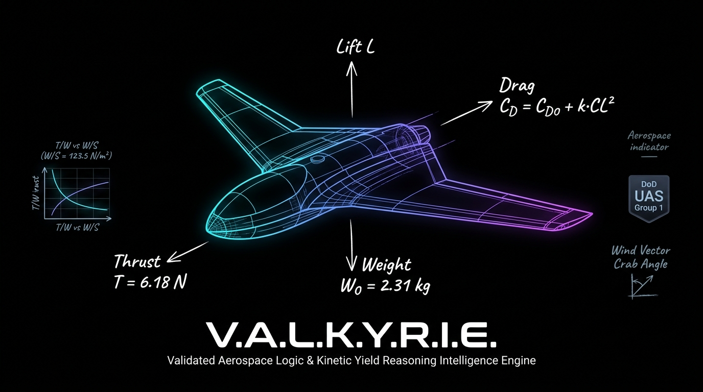
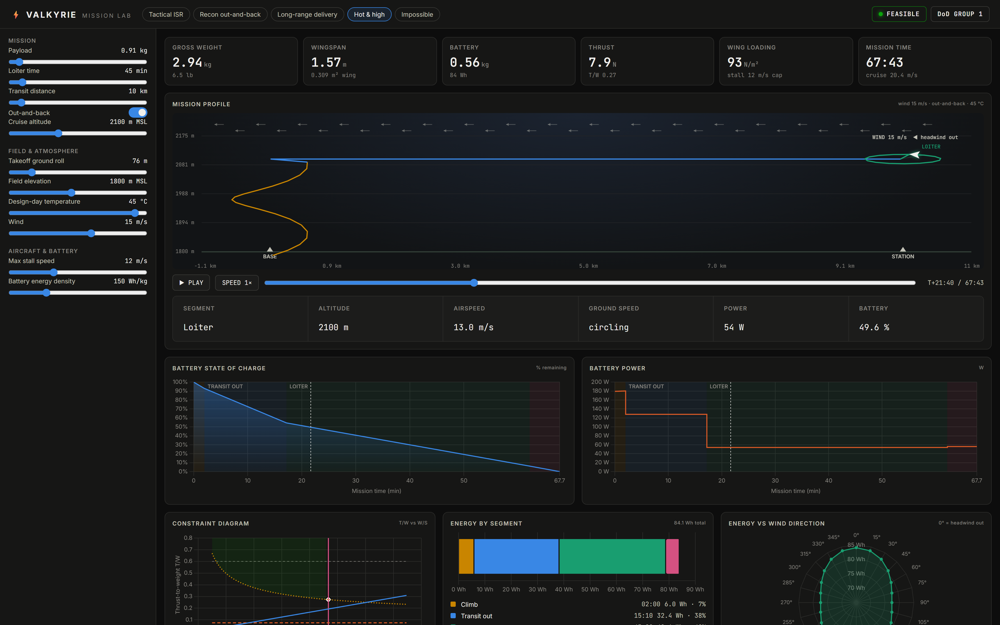
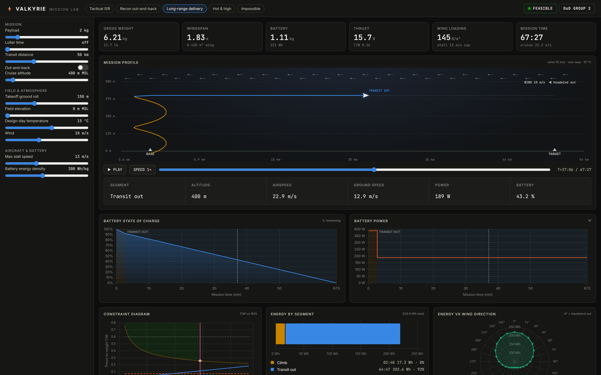
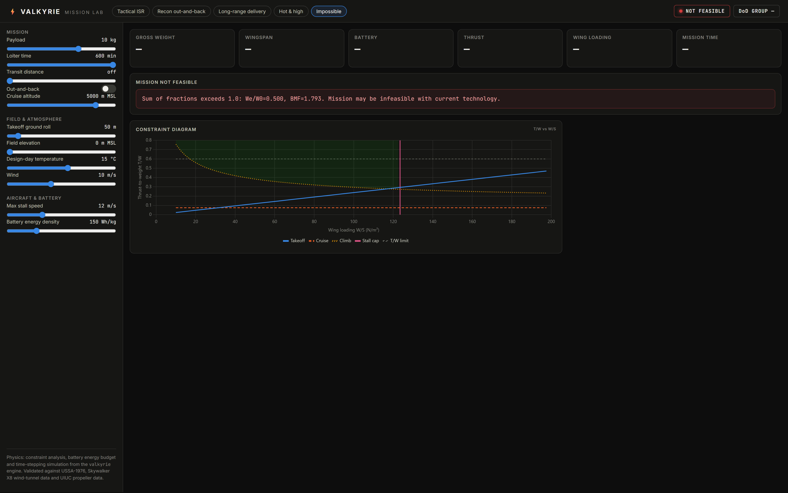
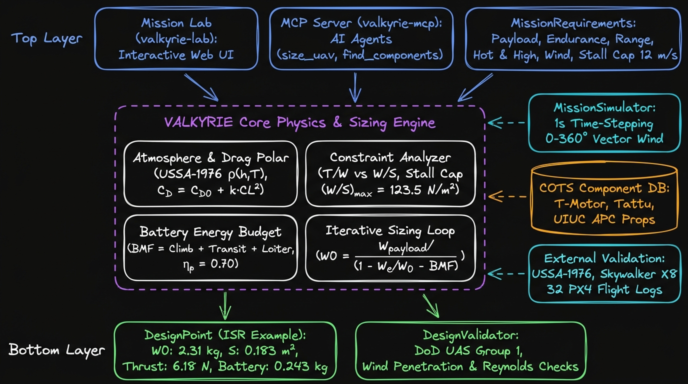

<div align="center">



# ⚡ V.A.L.K.Y.R.I.E.

**Validated Aerospace Logic & Kinetic Yield Reasoning Intelligence Engine**

*Know if your drone can fly the mission before you build it.*

[](https://www.python.org/downloads/)
[](LICENSE)
[](https://modelcontextprotocol.io)
[](https://github.com/astral-sh/ruff)
[](http://mypy-lang.org/)

[Mission Lab](#️-mission-lab) • [Quick Start](#-quick-start) • [MCP](#-use-it-from-claude-mcp) • [Military Checks](#-military-operating-checks) • [Validation](#-validation) • [Docs](#-documentation) • [Roadmap](#-roadmap)

</div>

---

## 🎯 The Problem

**Most small-scale UAVs fly by accident.**

The typical development process:
1. Sketch on paper 📝
2. Jump straight into CAD 🖥️
3. Pick a motor from static thrust tables ⚡
4. Cross fingers and maiden flight 🤞

In hobbyist prototyping, trial-and-error is acceptable. **In defense tech, autonomous systems, and physical AI platforms, skipping first-principles aerospace engineering destroys payload capacity, endurance margins, and program timelines before a single rib is cut.**

VALKYRIE sizes a small electric fixed-wing aircraft from its mission (payload, endurance, range, field, altitude, weather), and says plainly when the mission is impossible.

### Who It's For

- **Defense & tactical UAS teams**: check a CONOPS against physics before a program commits: DoD UAS Group, wind penetration and hot-and-high field performance come out of every sizing run
- **UAV builders**: RC, FPV and fixed-wing people who want to know the battery and wing size *before* the maiden flight
- **Aerospace students**: textbook conceptual sizing (Raymer, Anderson, Mattingly) as readable, tested, validated Python
- **Agent builders**: an MCP server, so an LLM can answer "is this mission physically possible?" with physics instead of a guess

---

## 🛰️ Mission Lab

<div align="center">

<br><em>Hot-and-high recon from a 1,800 m strip at 45 °C in 15 m/s wind: spiral climb, transit, loiter orbit and return, simulated step by step.</em>
</div>

```bash
pip install -e .
valkyrie-lab            # opens http://127.0.0.1:8765
```

Drag a slider and the aircraft is re-sized, re-simulated and re-plotted:
an animated mission profile with live telemetry, battery state of charge and power over time,
the constraint diagram with the design point, energy by segment, energy vs wind direction,
the DoD UAS Group and every engineering check. Same engine as the library and MCP server.

| | |
|---|---|
|  |  |
| *50 km into a 10 m/s headwind: 22.9 m/s airspeed, 12.9 m/s over the ground* | *10 kg for 10 hours: rejected, with the reason* |

---

## 🏗️ System Architecture

<div align="center">

<br><em>Mission CONOPS & MCP client → VALKYRIE physics & sizing engine → validated design point</em>
</div>

1. **Mission input**: payload, endurance and/or range (one-way or out-and-back), field elevation, cruise altitude, temperature, wind, stall speed; from Python or an LLM over MCP.
2. **Physics engine**: constraint analysis (T/W vs W/S), parabolic drag polar, battery energy budget for climb, transit (with wind) and loiter, iterative weight closure.
3. **Validated design point**: weight, wing, thrust, battery, DoD UAS Group and every failed check, or the physical reason the mission can't be flown.

How each step works, with equations and sources: **[docs/theory.md](docs/theory.md)**.

---

## 🚀 Quick Start

```bash
git clone https://github.com/madhavmadupu/valkyrie-mcp.git
cd valkyrie-mcp
python -m venv venv && source venv/bin/activate   # Windows: venv\Scripts\activate
pip install -e .
```

```python
from valkyrie import MissionRequirements, ConstraintAnalyzer

mission = MissionRequirements(
    payload_mass_kg=0.91,        # 2.0 lb EO/IR camera
    endurance_hours=0.75,        # 45 minutes on station
    takeoff_distance_m=76,       # 250 ft grass field
    cruise_altitude_m=300,       # low-altitude surveillance
)
design = ConstraintAnalyzer(mission).solve()

print(f"Gross weight:  {design.gross_weight_kg:.2f} kg")
print(f"Wing area:     {design.wing_area_m2:.3f} m²")
print(f"Thrust:        {design.required_thrust_n:.2f} N")
print(f"Battery:       {design.battery_mass_kg:.3f} kg")
```

```
Gross weight:  2.31 kg
Wing area:     0.183 m²
Thrust:        6.18 N
Battery:       0.243 kg
```

Impossible missions fail loudly instead of returning a fantasy aircraft:

```python
MissionRequirements(payload_mass_kg=10, endurance_hours=10, takeoff_distance_m=50, cruise_altitude_m=5000)
# ConvergenceError: Sum of fractions exceeds 1.0: We/W0=0.500, BMF=1.793.
```

All mission inputs, outputs and a full walkthrough: **[docs/getting-started.md](docs/getting-started.md)**.

---

## 🤖 Use it from Claude (MCP)

```bash
pip install -e .
claude mcp add valkyrie -- valkyrie-mcp       # Claude Code
```

Claude Desktop (`claude_desktop_config.json`):

```json
{ "mcpServers": { "valkyrie": { "command": "valkyrie-mcp" } } }
```

Then ask: *"Can a fixed-wing drone carry a 2 lb camera for 45 minutes and take off in 250 ft?"*
or *"Same mission from a 6,000 ft strip at 45 °C in 15 m/s wind: what DoD group, and does it still work?"*

| Tool | What it does |
|------|--------------|
| `size_uav` | Sizes the aircraft for payload + endurance and/or range (one-way or round trip), wind, temperature and field elevation; returns the design, DoD UAS Group and failed checks, or `feasible: false` with the physical reason |
| `find_components` | Looks up motors, batteries and propellers from the built-in COTS database |

Works with `mcp` 1.x and 2.x.

---

## 🪖 Military Operating Checks

| Check | What it does |
|-------|-----------------|
| **DoD UAS Group (1–5)** | Classifies the design by weight, altitude (AGL/MSL) and airspeed; the highest attribute wins, per the DoD group table |
| **Wind penetration** | Error if cruise airspeed can't beat the required wind (blown off station); warning if upwind ground speed drops below half airspeed |
| **Wind in the energy budget** | Transit is flown at the energy-optimal airspeed with the wind along the track: headwind on a one-way leg, headwind out and tailwind home on a round trip. A 50 km one-way leg needs 0.71 kg of battery in still air, 2.03 kg into 10 m/s |
| **Hot and high** | Design-day temperature and field elevation lower air density: the stall-limited wing grows and takeoff needs more thrust. 45 °C at an 1,800 m strip: wing +32% |

```python
from valkyrie.analysis import DesignValidator

mission = MissionRequirements(
    payload_mass_kg=0.91, endurance_hours=0.75, takeoff_distance_m=76,
    field_elevation_m=1800, cruise_altitude_m=2100,   # high-altitude strip
    temperature_celsius=45, max_wind_speed_ms=15,      # hot day, gusty
)
design = ConstraintAnalyzer(mission).solve()
validator = DesignValidator(mission, design)
validator.validate_all()
print(validator.uas_group(), validator.summary())      # 1, wind_penetration_marginal warning
```

Details and thresholds: **[docs/theory.md § Military operating checks](docs/theory.md#7-military-operating-checks)**.

---

## 🔬 Validation

Tests prove the code is self-consistent; validation checks it against **outside evidence**. Full report with figures: **[docs/validation.md](docs/validation.md)** (regenerated by `validation/run_validation.py`).

| Model piece | Checked against | Result |
|---|---|---|
| Air density | U.S. Standard Atmosphere 1976 | max error 0.001% to 11 km |
| Parabolic drag polar | Skywalker X8 measured aerodynamic model | (L/D)max within 0.8% |
| Default drag (CD0 0.025, e 0.80) | X8 measured model / AeroSandbox Raven-class buildup | 5% / 10% *conservative* |
| Propeller efficiency 0.70 | UIUC wind tunnel, APC 11–16 in props | measured peaks 0.68–0.79 |
| Battery energy budget | Independent time-stepping simulator | within 0.11% on 4 missions |
| "Along-track wind is worst case" | Simulator, 0–180° wind sweep | confirmed |
| **Cruise power, real aircraft** | **346 public PX4 flight logs → 32 usable flights, 9 Albatross UAVs** | **measured / predicted median 1.18** |
| **Endurance from battery energy** | **Penguin BE datasheet (640 Wh, 2.8 kg payload)** | **within 3–6% of the published 110 min** |
| CLmax default 1.4 | Penguin BE datasheet | published 1.3 clean, 1.7 flapped |
| Empty-weight fraction 0.50 | Albatross, Penguin BE datasheets | 0.44, 0.49 (default not optimistic) |
| Whole sizing from payload + endurance | Penguin BE, Skylark I-LEX datasheets | −40%, +34%: a first estimate |

<div align="center">

<br><em>Real flights vs VALKYRIE: battery power in steady level flight from public PX4 logs, against the prediction from published geometry and default assumptions (nothing fitted).</em>
</div>

Validation changed the model: propeller efficiency dropped from 0.80 to 0.70 after the UIUC data, climb energy was added after the simulator exposed it, and the parts database was rebuilt from manufacturer pages. On real Albatross flights the defaults under-predict cruise power by a median 18%, which is in line with avionics and payload drawing from the same battery. The datasets are in [`validation/data/`](validation/data/), every row traceable to a public log, a datasheet or a Wikipedia revision. **Still missing:** a flight log of a *weighed* aircraft ([CONTRIBUTING.md](CONTRIBUTING.md)).

---

## 📖 Documentation

| Doc | What's in it |
|---|---|
| [Getting started](docs/getting-started.md) | Install, Mission Lab, every mission input, reading the outputs, MCP setup, simulation |
| [Theory](docs/theory.md) | Every equation, every default and where it comes from |
| [Validation](docs/validation.md) | Evidence against standards, wind-tunnel data and independent tools |
| [References](docs/references.md) | Books, papers and datasets |
| [Worked example](examples/designs/tactical_field_uav/) | 2 lb-payload, 45-minute ISR UAV from requirements to design |

---

## 🗺️ Roadmap

### ✅ Done (v0.1.x)
- [x] Constraint analysis (T/W vs W/S) with stall/landing-limited wing loading
- [x] Battery energy budget: climb, transit (one-way and out-and-back, with wind), loiter
- [x] Military operating checks: DoD UAS Group, wind penetration, hot-and-high
- [x] Time-stepping mission simulator
- [x] Validation suite against USSA-1976, Skywalker X8, UIUC propeller data, AeroSandbox
- [x] MCP server (`size_uav`, `find_components`)
- [x] Mission Lab: interactive sizing, simulation and plots in the browser (`valkyrie-lab`)

### 🎯 Next (v0.2.0)
- [ ] End-to-end validation against a real flight log
- [ ] Empty-weight model that scales with size and wing area (replaces the fixed 50% fraction)
- [ ] Battery reserve, Peukert effect, payload + avionics power draw
- [ ] Motor power sizing (P = T·V/η) wired to the component database
- [ ] Max dash speed sizing, so the DoD group and wind checks use dash speed, not cruise
- [ ] Plotted constraint diagram generated from the solver
- [ ] Hybrid / ICE propulsion (Group 2–3 aircraft); currently rejected with a clear error

**Vision:** No one should have to maiden-fly an aircraft to find out whether its mission was possible.

---

## 🤝 Contributing

We welcome contributions from aerospace engineers, defense tech developers, and autonomy researchers. The most valuable one right now is **a flight log** (mass, wing area, battery energy used, airspeed, wind) to validate endurance end to end.

See [CONTRIBUTING.md](CONTRIBUTING.md).

---

## 📜 Citation

```bibtex
@software{valkyrie_mcp,
  author = {Madupu, Madhav},
  title = {VALKYRIE: Validated Aerospace Logic \& Kinetic Yield Reasoning Intelligence Engine},
  year = {2026},
  url = {https://github.com/madhavmadupu/valkyrie-mcp},
  note = {Physics-aware mission intelligence for autonomous systems}
}
```

---

## 🌟 From the Author

> "I've watched defense tech startups waste months building UAVs that couldn't meet their stated endurance requirements. I've seen military operators request missions that violated basic aerodynamics. Intelligence platforms fuse data brilliantly but can't answer: *'Is this even possible?'*
>
> VALKYRIE enforces the laws of physics before you commit resources. No more accidental flight."
>
> — **Madhav Madupu**, Aerospace Systems Engineer

---

## ⚖️ License

Apache License 2.0 - See [LICENSE](LICENSE) for details.

## 🔗 Links

- **Documentation:** [madhavmadupu.github.io/valkyrie-mcp](https://madhavmadupu.github.io/valkyrie-mcp)
- **Issues/Features:** [GitHub Issues](https://github.com/madhavmadupu/valkyrie-mcp/issues)
- **Author:** [Madhav Madupu](https://github.com/madhavmadupu) | [LinkedIn](#) | madhav.madupu@gmail.com

---

<div align="center">

**⚡ Built for engineers who refuse to let aircraft fly by accident. ⚡**

[⭐ Star this repo](https://github.com/madhavmadupu/valkyrie-mcp) if VALKYRIE saves you from an impossible UAV design!

</div>
