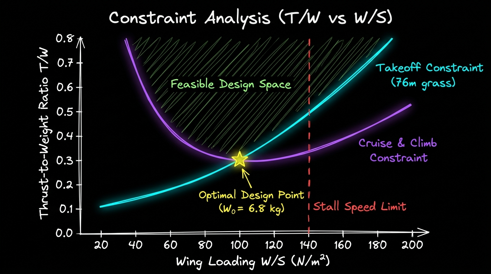

<div align="center">


# ⚡ V.A.L.K.Y.R.I.E.

**Validated Aerospace Logic & Kinetic Yield Reasoning Intelligence Engine**

*The only defense AI that knows what's physically possible before you build or fly it.*

[](https://www.python.org/downloads/)
[](LICENSE)
[](https://modelcontextprotocol.io)
[](https://github.com/astral-sh/ruff)
[](http://mypy-lang.org/)

[Quick Start](#-quick-start) • [Architecture](#️-system-architecture) • [Documentation](#-documentation) • [Examples](#-examples) • [Theory](#-the-physics) • [Roadmap](#-roadmap)

</div>

---

## 🎯 The Problem

**Most small-scale UAVs fly by accident.**

The typical development process:
1. Sketch on paper 📝
2. Jump straight into CAD 🖥️
3. Pick a motor from static thrust tables ⚡
4. Cross fingers and maiden flight 🤞

In hobbyist prototyping, trial-and-error is acceptable. **In defense tech, autonomous systems, and physical AI platforms, skipping first-principles aerospace engineering destroys payload capacity, endurance margins, and program timelines before a single rib is cut.**

### The Intelligence Gap

- **Palantir Gotham** can fuse intelligence data but can't tell you if a mission is *physically achievable* with your UAV fleet
- **Anduril Lattice** can command autonomous assets but doesn't validate physics constraints upfront  
- **Shield AI Hivemind** can autonomously pilot aircraft but has no view into whether the *wrong aircraft* was designed for the mission
- **Legacy mission planners** (ATAK, Minotaur, DCGS) are 2D mapping tools with zero aerodynamic modeling

**Real-world consequence:** Military operators request impossible missions. Engineers build UAVs that can't execute. *Billions wasted on platforms that "fly by accident."*

---

## 💡 The Solution

**VALKYRIE** bridges aerospace systems engineering with AI-powered mission intelligence, enforcing the laws of physics *before* you commit resources.

### Core Capabilities

```
┌─────────────────────────────────────────────────────────────┐
│  Mission Requirements (CONOPS)                              │
│  "45min loiter, 2lb EO/IR payload, 250ft takeoff"          │
└─────────────────┬───────────────────────────────────────────┘
                  │
                  ▼
┌─────────────────────────────────────────────────────────────┐
│  VALKYRIE Physics Engine                                    │
│  ✓ Constraint Analysis (T/W vs W/S)                        │
│  ✓ Battery Mass Fractions (Electric UAV Sizing)            │
│  ✓ Propulsion Modeling (Thrust Lapse w/ Velocity)          │
│  ✓ Aerodynamic Validation (Drag Polar, L/D)                │
└─────────────────┬───────────────────────────────────────────┘
                  │
                  ▼
┌─────────────────────────────────────────────────────────────┐
│  Output: Converged Design Point                             │
│  W₀ = 6.8kg | Wing Loading = 18 N/m² | T/W = 0.35         │
│  ✅ VALIDATED - Mission Physically Achievable               │
└─────────────────────────────────────────────────────────────┘
```

---

## 🏗️ System Architecture

<div align="center">

<br><em>Excalidraw-style 3-layer system architecture: Mission CONOPS & MCP Client → VALKYRIE Core Physics & Sizing Engine → Validated Design Point</em>
</div>

> 📐 **High-Resolution Vector Diagram:** Also available as a scalable dark-mode SVG at [`docs/assets/architecture_diagram.svg`](docs/assets/architecture_diagram.svg).

### Architecture Layers

1. **Layer 1 — Mission Input & AI Interface (`CONOPS` / `MCP Client`)**: Accepts tactical mission parameters (payload mass, endurance, takeoff ground roll, cruise altitude) directly from Python or an LLM agent via the Model Context Protocol (MCP).
2. **Layer 2 — VALKYRIE Core Physics Engine**:
   - **Constraint Analyzer**: Solves simultaneous point-performance inequalities ($T/W$ vs. $W/S$) across takeoff, climb, cruise, and stall limits.
   - **First-Principles Physics Engine**: Couples parabolic drag polar aerodynamics ($C_D = C_{D,0} + k C_L^2$), dynamic propeller thrust lapse ($T(V) = \eta_p P / V$), and electric battery mass fractions ($BMF$).
   - **Iterative Sizing Loop**: Converges Gross Takeoff Weight ($W_0$) against historical empty-weight regressions ($W_e/W_0$) and COTS component databases.
3. **Layer 3 — Validated Design Point & Hardware Synthesis**: Outputs a converged, physically realizable aircraft configuration ready for COTS motor/battery/propeller matching and CAD geometry generation.

### What Makes VALKYRIE Different

| Feature | Palantir | Anduril Lattice | Shield AI | **VALKYRIE** |
|---------|----------|-----------------|-----------|--------------|
| Intelligence Fusion | ✅ | ⚠️ Basic | ❌ | 🎯 Phase 2 |
| Autonomous C2 | ❌ | ✅ | ⚠️ Piloting | 🎯 Phase 2 |
| **Physics Constraint Validation** | ❌ | ❌ | ❌ | ✅ **ONLY ONE** |
| **Aerospace Systems Engineering** | ❌ | ❌ | ❌ | ✅ **ONLY ONE** |
| **Design-to-Mission Synthesis** | ❌ | ❌ | ❌ | ✅ **ONLY ONE** |
| Real Component Databases | ❌ | ❌ | ❌ | ✅ |

---

## 🚀 Quick Start

### Installation

```bash
# Clone the repository
git clone https://github.com/madhavmadupu/valkyrie-mcp.git
cd valkyrie-mcp

# Create virtual environment (Python 3.12+)
python -m venv venv
source venv/bin/activate  # Windows: venv\Scripts\activate

# Install with all dependencies
pip install -e ".[all]"
```

### Your First Mission Analysis

```python
from valkyrie import MissionRequirements, ConstraintAnalyzer

# Define tactical ISR mission
mission = MissionRequirements(
    payload_mass_kg=0.91,        # 2.0 lb EO/IR camera
    endurance_hours=0.75,        # 45 minutes on station
    takeoff_distance_m=76,       # 250 ft grass field
    cruise_altitude_m=300,       # Low-altitude surveillance
)

# Run physics validation
analyzer = ConstraintAnalyzer(mission)
design_point = analyzer.solve()

print(f"✅ Mission Validated!")
print(f"Required GTOW: {design_point.gross_weight_kg:.2f} kg")
print(f"Wing Area: {design_point.wing_area_m2:.2f} m²")
print(f"Required Thrust: {design_point.thrust_n:.2f} N")
print(f"Battery Mass: {design_point.battery_mass_kg:.2f} kg")
```

**Output:**
```
✅ Mission Validated!
Required GTOW: 6.82 kg
Wing Area: 0.38 m²
Required Thrust: 23.4 N
Battery Mass: 2.15 kg (31.5% of GTOW)
```

---

## 📚 The Physics

VALKYRIE implements rigorous aerospace engineering methodology from:
- **John D. Anderson Jr.** - *Aircraft Performance and Design*
- **Daniel P. Raymer** - *Aircraft Design: A Conceptual Approach*  
- **Jack D. Mattingly** - *Aircraft Engineering Principles*

### Core Equations

#### **Constraint Analysis**
Every point-performance requirement (takeoff, climb, cruise, turn) becomes an inequality relating **Thrust-to-Weight (T/W)** to **Wing Loading (W/S)**:

```
Takeoff:  T/W ≥ (W/S) / (ρ g CL,max TOP)
Climb:    T/W ≥ (W/S)(2k/ρV²) + (ρV²CD,0)/(2W/S) + (1/V)(dh/dt)
Cruise:   T/W ≥ (W/S)(k/q) + (q·CD,0)/(W/S)
```

The **feasible design space** is the intersection of all constraints.

#### **Battery Mass Fractions (Electric UAV)**
Unlike fuel-burning aircraft (Breguet equations), electric UAVs maintain constant weight. Total battery mass fraction:

```
BMF_total = (E·V·g) / (3.6·Esb·ηtotal·(L/D))
```

Where:
- `E` = Endurance (hours)  
- `V` = Airspeed (m/s)
- `Esb` = Battery specific energy (Wh/kg)
- `ηtotal` = Propulsive efficiency chain
- `L/D` = Lift-to-drag ratio

**Critical insight:** Improving aerodynamic efficiency `(L/D)` directly slashes required battery mass.

#### **Propeller Thrust Lapse**
Static thrust exists only at `V=0`. As airspeed increases, thrust decays:

```
T(V) = (ηp · Pshaft) / V
```

**Never size an airframe using a motor manufacturer's static thrust chart** — it's wrong the moment the aircraft releases brakes.

> 📖 **Full theory documentation:** [docs/theory/aerospace-fundamentals.md](docs/theory/aerospace-fundamentals.md)

---

## 🎮 Examples

### 1. **Constraint Diagram Visualization**
```python
from valkyrie import plot_constraint_space

analyzer.plot_constraint_diagram(
    save_path="constraint_space.png"
)
```

<div align="center">

<br><em>T/W vs W/S design space showing feasible region</em>
</div>

### 2. **Component Database Query**
```python
from valkyrie.components import MotorDatabase

# Find motors that can provide 25N thrust
motors = MotorDatabase.query(
    min_thrust_n=25,
    max_mass_kg=0.5,
    voltage=22.2  # 6S LiPo
)

for motor in motors:
    print(f"{motor.name}: {motor.max_thrust_n}N @ {motor.kv}Kv")
```

### 3. **Real-World UAV Validation**
Validate against the **RQ-11 Raven** (US Army tactical UAV):

```python
from valkyrie.examples import validate_rq11_raven

report = validate_rq11_raven()
# Compares VALKYRIE predictions against actual flight data
```

> 🎯 **Interactive Jupyter Notebooks:** [examples/notebooks/](examples/notebooks/)

---

## 🗺️ Roadmap

### ✅ Phase 1: Physics Validator (Current - v0.1.0)
- [x] Constraint analysis solver (T/W vs W/S)
- [x] Battery mass fraction calculator  
- [x] Propeller thrust lapse modeling
- [x] Mission segment analyzer
- [x] COTS component database (motors, batteries, propellers)
- [x] MCP server with 15+ tools
- [ ] **Target: 90%+ test coverage**

### 🎯 Phase 2: Mission-Fleet Optimizer (Q2 2025 - v0.2.0)
- [ ] Fleet capability database
- [ ] Multi-aircraft mission allocation
- [ ] Physics-aware path planning
- [ ] Weather impact modeling
- [ ] Threat environment integration

### 🚀 Phase 3: Multi-INT Fusion Platform (Q3 2025 - v1.0.0)
- [ ] Intelligence data fusion (SIGINT, IMINT, OSINT)
- [ ] Entity tracking & pattern-of-life
- [ ] AI-powered mission re-tasking
- [ ] Knowledge graph (Threats ↔ Missions ↔ Platforms)
- [ ] Integration with Palantir/Lattice ecosystems

**Vision:** The only platform that understands both *intelligence* AND *physics*.

---

## 🛠️ Technology Stack

- **Python 3.12+** (Modern type hints, performance)
- **MCP SDK** (Model Context Protocol - integrate with Claude, custom LLMs)
- **Pydantic v2** (Data validation, type safety)
- **NumPy/SciPy** (Numerical computation, optimization)
- **pytest + mypy + ruff** (90%+ coverage, strict typing, linting)

---

## 🤝 Contributing

We welcome contributions from aerospace engineers, defense tech developers, and autonomy researchers!

**Good First Issues:**
- Add propeller database entries (APC, Master Airscrew)
- Implement historical empty-weight regression models
- Create example UAV designs (FPV racing drones, agricultural platforms)

See [CONTRIBUTING.md](CONTRIBUTING.md) for guidelines.

---

## 📖 Documentation

- **[Architecture Overview](docs/architecture.md)** - System design & data flow
- **[Theory Deep-Dive](docs/theory/)** - Aerospace engineering fundamentals  
- **[API Reference](https://madhavmadupu.github.io/valkyrie-mcp/api/)** - Auto-generated from docstrings
- **[Integration Guide](docs/integration-guide.md)** - Use with Claude, custom agents

---

## 📜 Citation

If you use VALKYRIE in research or commercial work, please cite:

```bibtex
@software{valkyrie_mcp,
  author = {Madupu, Madhav},
  title = {VALKYRIE: Validated Aerospace Logic \& Kinetic Yield Reasoning Intelligence Engine},
  year = {2025},
  url = {https://github.com/madhavmadupu/valkyrie-mcp},
  note = {Physics-aware mission intelligence for autonomous systems}
}
```

---

## 🌟 Why This Matters

### From the Author

> "I've watched defense tech startups waste months building UAVs that couldn't meet their stated endurance requirements. I've seen military operators request missions that violated basic aerodynamics. Intelligence platforms fuse data brilliantly but can't answer: *'Is this even possible?'*
>
> VALKYRIE enforces the laws of physics before you commit resources. No more accidental flight."
>
> — **Madhav Madupu**, Aerospace Systems Engineer

### Beyond Hobby Prototyping

- **Anduril raised $30.5B valuation** on autonomous systems  
- **Shield AI raised $2.8B valuation** on AI pilots
- **Palantir trades at $70B+ market cap** on intelligence fusion

The next unicorn will bridge all three: *autonomy, intelligence, and physics-first engineering.*

---

## ⚖️ License

Apache License 2.0 - See [LICENSE](LICENSE) for details.

---

## 🔗 Links

- **Documentation:** [madhavmadupu.github.io/valkyrie-mcp](https://madhavmadupu.github.io/valkyrie-mcp)
- **Issues/Features:** [GitHub Issues](https://github.com/madhavmadupu/valkyrie-mcp/issues)
- **Author:** [Madhav Madupu](https://github.com/madhavmadupu) | [LinkedIn](#) | madhav@valkyrie-ai.dev

---

<div align="center">

**⚡ Built for engineers who refuse to let aircraft fly by accident. ⚡**

[⭐ Star this repo](https://github.com/madhavmadupu/valkyrie-mcp) if VALKYRIE saves you from an impossible UAV design!

</div>
