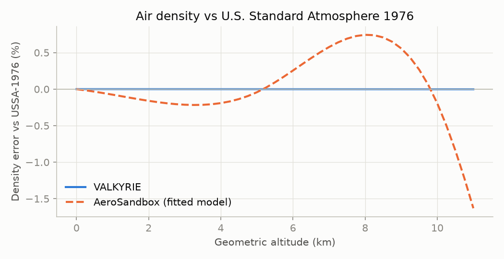
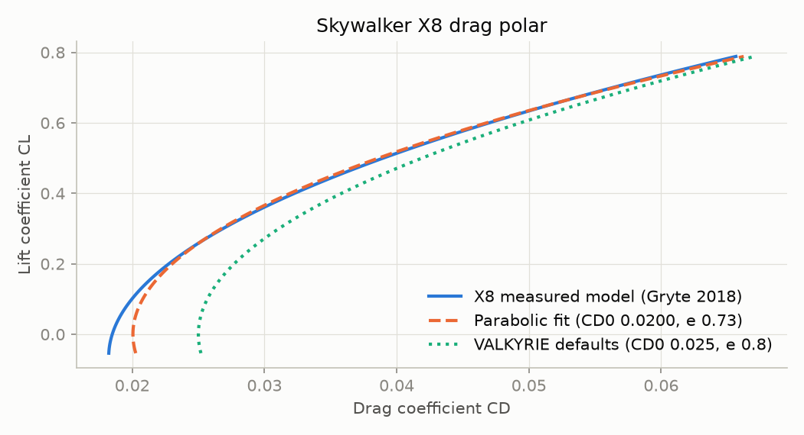
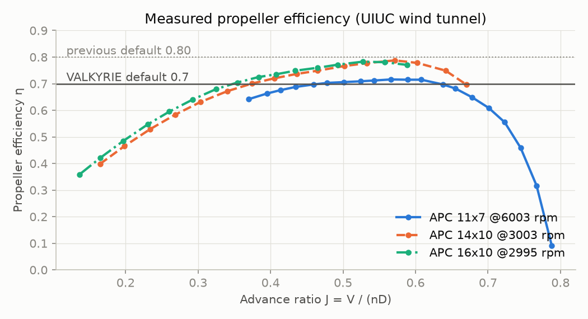
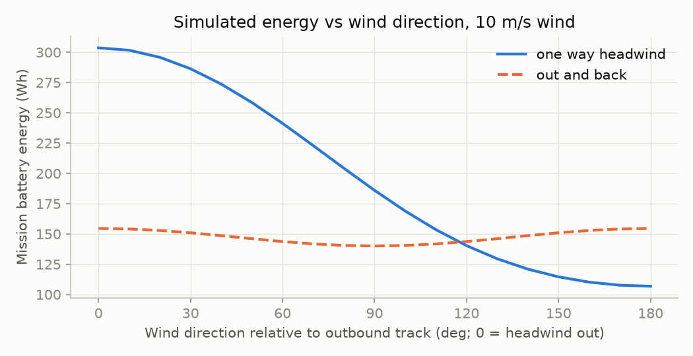
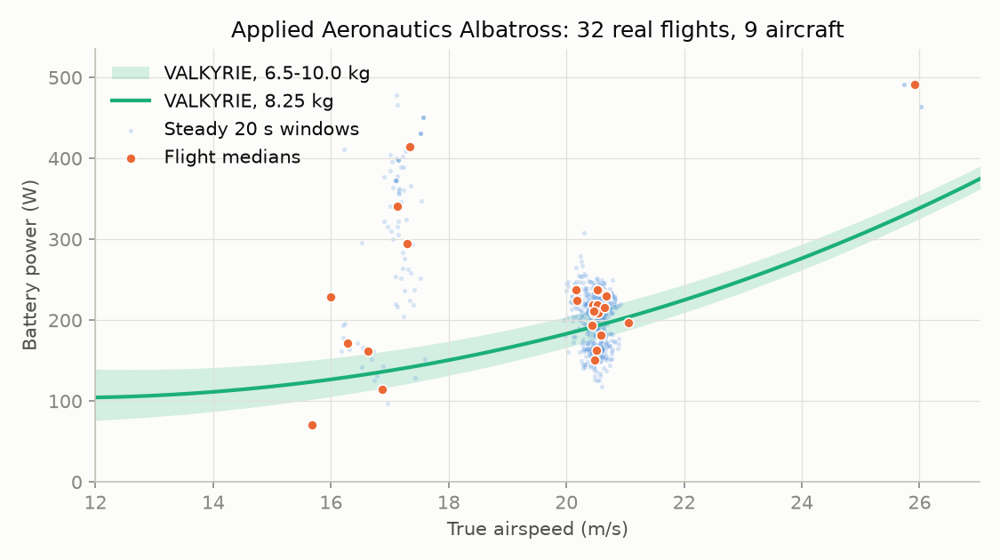

# Validation

_Generated by `validation/run_validation.py` on 2026-11-08. Do not edit by hand; rerun the script._

VALKYRIE's tests check that the code is internally consistent. This page checks it against **outside evidence**: published standards, wind-tunnel data, real flight logs, manufacturer datasheets, an independent design tool and an independent simulation. Each study says what it validates and what it does not.

## Summary

| Model piece | Checked against | Result |
|---|---|---|
| Air density (ISA troposphere) | U.S. Standard Atmosphere 1976 | max error 0.001% to 11 km |
| Parabolic drag polar | Skywalker X8 measured model | (L/D)max reproduced within 0.8% |
| Default CD0 = 0.025, e = 0.8 | X8 measured model | (L/D)max -5.4% (conservative) |
| Default CD0 = 0.025, e = 0.8 | AeroSandbox AeroBuildup, Raven-class | (L/D)max -9.5% (conservative) |
| Propeller efficiency 0.7 | UIUC wind tunnel, APC 11-16 in | measured peaks 0.68-0.79 |
| Battery energy budget | Time-stepping simulator | within 0.11% on 4 missions |
| Along-track wind is worst case | Simulator, 0-180° sweep | confirmed (worst at 0°) |
| Battery-energy endurance method | Traub 2013, wind-tunnel flight | literature: within 3% of measured |
| Cruise power, real aircraft | 32 PX4 flight logs, 9 Albatross UAVs | measured / predicted median 1.18 (IQR 1.08-1.47) |
| Endurance from battery energy | Penguin BE datasheet (640 Wh, 2.8 kg payload) | -6% to -3% vs published 110 min |
| CLmax default 1.4 | Penguin BE datasheet | published 1.3 clean, 1.7 flapped |
| Empty-weight fraction 0.50 | Albatross, Penguin BE datasheets | 0.44, 0.49 |
| Whole sizing loop | Penguin BE, Skylark I-LEX datasheets | -40%, +34% takeoff weight |

## 1. Atmosphere

`air_density()` against the U.S. Standard Atmosphere 1976 as implemented by [`ambiance`](https://github.com/airinnova/ambiance), with AeroSandbox's smooth fitted atmosphere shown for scale.

| Altitude (m) | USSA-1976 ρ (kg/m³) | VALKYRIE ρ | Error |
|---:|---:|---:|---:|
| 0 | 1.22500 | 1.22500 | -0.0000% |
| 1,000 | 1.11166 | 1.11166 | -0.0001% |
| 2,000 | 1.00655 | 1.00655 | -0.0002% |
| 3,000 | 0.90925 | 0.90925 | -0.0004% |
| 5,000 | 0.73643 | 0.73642 | -0.0006% |
| 8,000 | 0.52579 | 0.52578 | -0.0010% |
| 10,000 | 0.41351 | 0.41350 | -0.0013% |

Hot/cold days keep standard pressure and change only temperature (ρ ∝ 1/T). Above 11 km (stratosphere) the model is not valid; missions are capped at 10 km.

## 2. Drag polar vs a real aircraft (Skywalker X8)

Gryte et al. (2018) identified the X8's aerodynamics from wind-tunnel tests and vortex-lattice analysis. We fit VALKYRIE's parabolic polar CD = CD0 + k·CL² to that model over CL 0.1-0.8.

| | CD0 | e | (L/D)max |
|---|---:|---:|---:|
| X8 measured model | - | - | 12.85 |
| Parabolic fit | 0.0200 | 0.728 | 12.95 |
| VALKYRIE defaults at X8 AR 5.88 | 0.025 | 0.8 | 12.16 |

**Finding:** the parabolic form is adequate (fit error under 4% in CD). The default e = 0.8 is optimistic next to the X8's 0.73, but the default CD0 = 0.025 is conservative next to its 0.0200; net, the defaults give 5% *lower* (L/D)max than the real aircraft.

## 3. Drag assumptions vs AeroSandbox (Raven-class airframe)

[AeroSandbox](https://github.com/peterdsharpe/AeroSandbox) `AeroBuildup` (NeuralFoil section aerodynamics + component buildup) on a conventional airframe with the RQ-11 Raven's published 1.37 m span. Chord, tail and fuselage sizes and the NACA 2412 airfoil are **assumed**, so this is a plausibility check by an independent tool, not a measurement.

| | AR | CD0 | e | (L/D)max |
|---|---:|---:|---:|---:|
| AeroBuildup | 8.06 | 0.0197 | 0.760 | 15.73 |
| VALKYRIE defaults | 8.06 | 0.025 | 0.8 | 14.23 |

## 4. Propeller efficiency (UIUC wind tunnel)

Measured efficiency of APC Thin Electric propellers from the UIUC Propeller Data Site (Brandt & Selig). The 11x7E is in VALKYRIE's component database.

| Propeller, rpm | Peak η |
|---|---:|
| APC 11x7 @3003 | 0.675 |
| APC 11x7 @3995 | 0.687 |
| APC 11x7 @4997 | 0.697 |
| APC 11x7 @6003 | 0.716 |
| APC 14x10 @3003 | 0.788 |
| APC 16x10 @2995 | 0.783 |

**Finding:** the previous default of 0.80 was at or above every measured peak, and real cruise is off-peak. The default is now 0.7, which raised every battery estimate by about 14%. The old `PropellerModel` (peak 0.85 at J = 0.9) contradicted this data and was not used by sizing, so it was removed.

## 5. Closed-form budget vs simulation

`valkyrie.simulation.MissionSimulator` flies each sized design in 1 s steps: wind as a vector (crab angle and crosswind), air density re-evaluated every step in the climb, and each leg's airspeed found by trial instead of by the closed-form optimizer.

| Mission | Closed form (Wh) | Simulation (Wh) | Difference |
|---|---:|---:|---:|
| isr loiter | 36.51 | 36.47 | -0.11% |
| one way headwind | 303.85 | 303.67 | -0.06% |
| out and back | 154.69 | 154.55 | -0.09% |
| hot high transit loiter | 95.08 | 94.98 | -0.10% |

With the wind's speed fixed and its direction swept, the most expensive direction is 0° for one way headwind, 0° for out and back: wind along the track. Budgeting against along-track wind, as the sizing does, is therefore the worst case and not an underestimate.

## 6. Cruise power vs real flight logs (Applied Aeronautics Albatross)

Public PX4 flight logs from [PX4 Flight Review](https://review.px4.io) for airframe 2106, the Applied Aeronautics Albatross: 346 logs scanned, 32 usable flights from 9 different aircraft, 16 flight hours, 626 steady 20-second windows. A window counts only if the aircraft is airborne, straight (|roll| < 10°), level (|climb rate| < 0.25 m/s) and at steady airspeed, so the measured battery power (voltage × current) is the power for level flight at that true airspeed; a steady wind does not change it.

The prediction uses only published numbers: 3.0 m span and 6.5-10 kg (dry weight plus battery, up to the 10 kg MTOW) from the manufacturer's datasheet, the 0.684 m² wing from the designer's 2013 specification, and VALKYRIE's default CD0, e and efficiencies. No parameter is fitted to the logs.

| | Value |
|---|---:|
| Median cruise airspeed / battery power | 20.5 m/s / 222 W |
| Measured / predicted power at 8.25 kg, per flight | median 1.18, IQR 1.08-1.47 |
| Same, median of per-aircraft medians | 1.32 (range 0.57-2.95) |
| Flights inside the 6.5-10 kg prediction band | 19% |
| CD0 that would match each flight at 8.25 kg (median) | 0.031 (default 0.025) |
| Whole-flight average power / steady cruise power (median) | 1.01 |

Why measured power can exceed the prediction even with right aerodynamics: the battery also feeds the autopilot, radios and payload (cameras, gimbals), payload pods add drag, the true mass of each flight is unknown, and hobby current sensors are often uncalibrated.

Logs rejected, and why: bench or ground log (under 5 min airborne) 70; flown without a working airspeed sensor 66; no battery sensor logged 61; no 20 s of steady straight-and-level flight 60; current sensor reads zero or constant 44; no air-data topic 5; no airspeed topic 5; corrupt or truncated log 2; no land-detector topic 1.

## 7. Manufacturer datasheets

`validation/data/uav_datasheets.csv` holds only numbers printed in a manufacturer's own datasheet (or the X8 paper), with what each weight includes. Few small UAVs publish battery energy, wing area and an endurance at a stated payload together; the UAV Factory Penguin BE does.

**Endurance from battery energy (Penguin BE).** Published: 110 min with a 2.8 kg payload, 640 Wh LiPo, 3.3 m span, 0.79 m² wing, empty weight 14.9 kg including battery and landing gear, endurance in belly-landing configuration (gear removed; its mass, 0.0-0.8 kg here, is not published). VALKYRIE, with its defaults and the full 640 Wh:

| Mass (kg) | Speed | Airspeed (m/s) | Battery power (W) | Endurance (min) |
|---:|---|---:|---:|---:|
| 17.7 | published cruise, 22 m/s | 22.0 | 372 | 103 |
| 17.7 | best-range speed | 19.6 | 324 | 119 |
| 17.7 | minimum-power speed | 14.9 | 284 | 135 |
| 16.9 | published cruise, 22 m/s | 22.0 | 360 | 107 |
| 16.9 | best-range speed | 19.2 | 302 | 127 |
| 16.9 | minimum-power speed | 14.6 | 265 | 145 |

At the published 22 m/s cruise speed the prediction is -6% to -3% of the published 110 min. Flying at minimum-power speed would stretch it further; the published figure appears to be at cruise speed.

**CLmax.** The datasheet gives 1.3 clean and 1.7 with 45° flaps; VALKYRIE's flapless default of 1.4 sits between.

**Empty-weight fraction** (battery excluded, as VALKYRIE defines it):

| Aircraft | We/W0 | Basis |
|---|---:|---|
| Applied Aeronautics Albatross | 0.44 | dry weight / MTOW, both published |
| UAV Factory Penguin BE | 0.49 | (empty incl. battery − 640 Wh at 150 Wh/kg) / MTOW; battery mass estimated |

Both sit at or below VALKYRIE's fixed 0.50, so the default is not optimistic for these airframes; two aircraft are far too few for a regression.

**Whole sizing loop.** Each aircraft sized from its published payload and endurance alone (100 m takeoff, 300 m altitude, still air, defaults):

| Aircraft | Payload (kg) | Endurance (h) | Published W0 (kg) | VALKYRIE W0 (kg) | Error |
|---|---:|---:|---:|---:|---:|
| UAV Factory Penguin BE | 2.8 | 1.83 | 17.7 | 10.7 | -40% |
| Elbit Systems Skylark I-LEX | 1.2 | 3.00 | 7.5 | 10.1 | +34% |

Conceptual sizing from two numbers lands within about ±40%. The Penguin BE airframe is built for up to 6.6 kg of payload, so it is heavier than a minimum design for 2.8 kg; the Skylark is lighter than a 0.50 empty fraction allows. Treat VALKYRIE's takeoff weight as a first estimate, not a quote.

**Why not Wikipedia.** `validation/uav_database.py` crawls Wikipedia's UAV categories and parses the spec infoboxes of 293 articles (`validation/data/uav_specs.csv`). Only 16 are electric aircraft under 50 kg, several of them quadcopters, payload is almost never given, and some values are wrong at the source (the Wasp III article lists a 6.53 kg gross weight for a 0.43 kg aircraft). The crawl is kept for reference but not used for any conclusion.

## What is not validated yet

- **Endurance with the exact mass of a flight.** Public logs do not record takeoff mass, so section 6 compares against a mass band. A log with a weighed aircraft would close this.
- **Battery behaviour:** no Peukert effect, reserve or depth-of-discharge limit (Traub 2011/2013 shows discharge characteristics dominate the remaining uncertainty).
- **Payload and avionics power draw** are not in the energy budget.
- **Motor/ESC efficiencies** (0.85 / 0.95) are typical values, not measured here.

Sources for every number on this page: [references.md](references.md).
